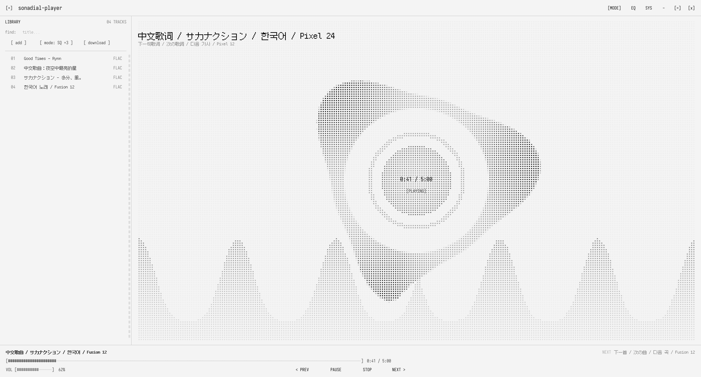

<p align="center">
  
</p>

# Sonadial Player

> Looks like a TUI, runs native. A terminal-styled music player with a beat-reactive radial spectrum, typewriter lyrics and gradient themes picked from each song's sound. Rust, single exe, lightweight.

仿 TUI 的原生桌面音乐播放器。外壳是终端风格：等宽点阵字体、方角、字符控件。底下是一条不阻塞的实时音频链路：解码、EQ、FFT 频谱、节拍与音高分析分在不同线程，界面只在需要时重绘。

Rust + egui（glow 后端）· Windows · 单文件 exe，字体内嵌，免安装

## 特色

### 仿 TUI 界面

- 无边框窗口、纯色背景、全局方角，布局统一使用 4 px 栅格的 design token（`src/design.rs`）
- 字符化控件：`[ add ]`、`[ download ]` 方括号按钮，行号选歌，字符进度条
- 内嵌 Sarasa Mono SC 子集作为英文与界面主字体；中、日、韩文分别使用 Fusion Pixel 12px 点阵子集，并微调基线，中英混排高度不错位
- 终端式打字机歌词：当前句带 `>` 前缀，宽 Insert 光标逐字打出，打完后停在句尾闪烁
- 三种视觉风格：DEFAULT（平滑圆环 + 像素 LED 墙）、DOT MATRIX（全点阵）、PIANO (DEV)（实验中；键盘 + 上行音符）

### 高性能

- 不阻塞的音频回调：解码线程与输出回调之间是 SPSC 无锁环形缓冲（ringbuf）；暂停、音量、进度、跳转状态都走原子量；EQ 参数用 `try_lock` 取快照，回调线程不会在锁上等待
- 线程隔离：解码、离线节拍分析、音符转录、下载与转码都在后台线程运行，UI 线程只做非阻塞轮询，任务可随时取消
- 按需重绘：播放时约 30 fps；暂停后频谱回落期间每 16 ms 一帧，回落结束即转入空闲，空闲时降到约 6 fps
- 预计算与复用：FFT plan、Hann 窗、100 根频段的分箱边界在启动时一次算好，采样、FFT 与视觉缓冲逐帧复用
- 只画点亮的部分：LED 墙按窗口宽度分列，只绘制点亮的单元
- 分析结果缓存：离线节拍与音符分析按「路径 + 文件大小 + 修改时间」缓存，重放同一首不会重新解码
- 输出缓冲：固定 512 帧的设备缓冲，加 2 秒输出环形缓冲吸收解码抖动
- Release 配置：`opt-level = 3`、thin LTO、`codegen-units = 1`、`panic = "abort"`、`strip`

### 功能

- 本地播放 MP3 / FLAC / WAV / OGG Vorbis / M4A（AAC、ALAC）/ AAC
- 播放列表、循环与随机、「下一首播放」队列、曲目右键菜单
- 10 段实时图形均衡器
- LRC 歌词自动匹配与手动导入
- 1024 点 FFT 圆环频谱、背景 LED 频谱墙、节拍驱动的圆心能量环
- PEAK HOLD 峰值帽
- 21 套内置主题、自定义主题编辑器，以及按歌曲类型生成渐变的 AUTO 主题
- B 站音频下载
- 每首歌单独记住音量；跟随系统默认输出设备，切换后自动重开音频流并保持进度

## 快速开始

需要 Rust stable 工具链。

```powershell
git clone https://github.com/Ovalene2333/sonadial-player.git
cd sonadial-player
cargo build --release
```

产物为 `target/release/sonadial_player.exe`。发布时复制为 `dist/SonadialPlayer.exe`，与 `dist/README.txt`、`dist/licenses/` 一起打包。release 版不会弹出控制台窗口。

- 把音频文件拖进窗口，或点左侧 `[ add ]`（`Ctrl+O`）
- 也可以把音频文件拖到 exe 上，启动后自动播放
- 首次点击窗口后，键盘快捷键才会生效

## 快捷键

| 按键 | 作用 |
| --- | --- |
| `Space` | 播放 / 暂停 |
| `↑` / `↓` | 音量 + / − |
| `←` / `→` | 后退 / 前进 5 秒 |
| `PgUp` / `PgDn` | 上一首 / 下一首 |
| `Ctrl+←` / `Ctrl+→` | 上一首 / 下一首 |
| `Ctrl+O` | 添加文件 |
| `Esc` | 关闭设置面板 |

## 播放

- 随机播放每次启动抽取一个固定随机顺序，上一首和下一首沿同一顺序前后移动
- 「下一首播放」队列优先于播放模式，并跳过已移除的文件
- 播放中拖动或点击进度条会接着播放；暂停、停止或播放结束时跳转只改变位置，点 PLAY 才继续出声
- 底部音量条在有当前曲目时显示为 TRK，音量记在这首歌上；没有当前曲目时修改默认音量
- 曲目右键菜单：播放、下一首播放、导入 / 清除 LRC、打开文件位置、从列表移除、永久删除

## 视觉

在 SYS 面板的 VISUALS 页设置，也可以点顶部 `[MODE]` 在三种风格间循环。

| MODE | 画面 |
| --- | --- |
| DEFAULT | 平滑圆环频谱、柔光圆心、像素 LED 背景墙 |
| DOT MATRIX | 背景换成小方点频谱，圆环拆成离散 LED 单元，圆心也用同一套方点绘制；轻拍只改变圆心亮度，重拍从圆外发出一圈点阵环 |
| PIANO (DEV) | 实验中：底部是钢琴键盘，音符条随播放向上移动；离线转录完成前用实时音高轨迹代替，结果可能不稳定 |

- LAYERS：背景频谱、圆环频谱、圆心跳动、歌词层可分别开关，圆环尺寸可调
- PEAK HOLD 只在圆环上绘制缓慢下落的峰值帽，不影响背景频谱
- 频谱慢速上升、平滑回落；暂停或停止时频谱柱逐渐归零，圆心能量环自然衰减
- 背景 LED 墙低频在两侧、高频在中间，左右两半交错取样；点亮区域只占底部 40%

## 歌词

- 自动匹配音频同目录下的同名 `.lrc`（如 `song.flac` + `song.lrc`），也可以在右键菜单选 `IMPORT LRC...` 手动指定；匹配结果会持久化，列表编号后的小 `L` 表示已匹配
- 只显示两行：当前句用 16px 点阵字体并带 `>` 前缀，下一句 12px 低亮度显示；两行左对齐在同一列，打字和换句时不抖动
- 打字速度按音节估算：中文 5 字 / 秒，英文按元音组折算为 4 音节 / 秒；单句最长约 10 秒，并以下一句开始前 100 ms 为硬上限
- 跳转后落地的那一句直接完整显示，下一句恢复逐字打字；歌词与音频共用播放时钟，连续跳转后仍保持同步
- 没有时间戳的纯文本歌词按曲目长度平均分配、自动轮播
- 支持 UTF-8（含 BOM）和带 BOM 的 UTF-16；没有歌词时不显示任何占位

## 均衡器

点顶部 `EQ` 打开。10 个频段（31 Hz – 16 kHz），范围 ±12 dB，内置 FLAT / POP / ROCK / CLASS / JAZZ / ELEC / VOCAL / BASS / TREBLE / DANCE 预设。EQ 在音频回调中实时处理，设置会持久化。

## 下载

点左侧 `[ download ]`，粘贴视频链接或 BV 号。目前接入 B 站，入口与界面按多源方式命名。

- 下载与转码在后台线程执行，不阻塞界面，可随时取消
- 有 AAC 音轨时直接保存为 m4a，不需要 ffmpeg；只有在没有 AAC 音轨或文件无法直接解析时，才调用 `PATH` 中的 `ffmpeg` 兜底
- 默认保存到 `%USERPROFILE%\Music\SonadialPlayer`

## 主题

SYS 面板的 THEME 页内置 21 套主题，每组深色在前、浅色在后。

| 分组 | 主题 | 风格 |
| --- | --- | --- |
| MONO | MONO / PAPER | 纯黑白灰 |
| TINT | SLATE / MOSS / DUSK / SAND / FOG / ROSE | 单一低饱和色调 |
| COLOR | BERRY / JADE / COBALT / BLUSH / MINT / AMBER | 单一彩色 |
| GRADIENT | AURORA / NEBULA / SUNSET / OCEAN / SHERBET / OPAL / MEADOW | 四角多色渐变 |
| CUSTOM | 用户主题 | 见下方 `themes.json` |

选中任意主题后点 CUSTOMIZE，会复制一份到 CUSTOM 并打开编辑器：可改名称、背景（纯色 / 双色斜向渐变 / 四角渐变）、强调色、频谱着色比例和深浅模式（AUTO 按背景亮度判断）。改动实时生效，文字颜色会自动提亮或压暗以保证可读性。

<details>
<summary>手写 themes.json</summary>

第一次 CUSTOMIZE 时自动生成，也可以手写：

```json
{
  "themes": [
    {
      "name": "MY AURORA",
      "background": ["#081A20", "#191825", "#3C1430", "#2B162B"],
      "accent": "#AA8CDC",
      "tint": 0.34,
      "dark": true,
      "colors": { "text_hi": "#F0E8FF" }
    }
  ]
}
```

| 字段 | 说明 |
| --- | --- |
| `name` | 显示名称，不能与其他主题重名（不区分大小写），UI 中最长 16 字符 |
| `background` | 1 个颜色为纯色；2 个为左上到右下斜向渐变；4 个为四角渐变，顺序是左上、右上、右下、左下 |
| `accent` | 强调色，用于频谱着色，并轻微染色文字、线条和警示色 |
| `tint` | 频谱中强调色的占比，0–1（默认 0.34；UI 调节范围 0–60%） |
| `dark` | 可省略，省略时按背景亮度判断深浅 |
| `colors` | 可选，逐项覆盖推导出的颜色：`bg`、`bg_deep`、`surface`、`surface_hi`、`surface_sunken`、`text_hi`、`text`、`text_dim`、`line`、`danger`。覆盖的颜色不做可读性修正，编辑器里可一键 CLEAR |

颜色格式为 `#RRGGBB`。手动修改后在 THEME 页点 RELOAD。

- 文件格式错误时会提示行列号，自定义主题暂时只读，修好后再 RELOAD
- 单个主题有问题（重名、背景颜色数量不对）只跳过该条，并在 THEME 页提示
- 程序运行期间文件被外部修改过时，UI 的改动不会覆盖它，需要先 RELOAD

</details>

### AUTO 主题

THEME 页最上方的 AUTO DARK / AUTO LIGHT 只选明暗，配色按当前歌曲生成，始终是四角渐变。先按音频特征把歌分成 7 类，每类有自己的配色：

| 类型 | 配色 |
| --- | --- |
| PIANO | 靛蓝、钢蓝，最安静 |
| EPIC | 海军蓝、青绿配余烬金 |
| BALLAD | 梅紫、藕荷、玫瑰 |
| POP | 糖果紫、水蓝、粉、桃 |
| ROCK | 炭灰配深红、焦橙 |
| ELEC | 霓虹蓝、青、品红、紫 |
| PHONK | 近黑紫配血红，略暗；嘻哈和 trap 一般也归这里 |

同一类型内，再按这首歌和同类歌相比的四项特征做变化，配色家族不变：

| 特征 | 听感 | 画面 |
| --- | --- | --- |
| TONE | 高频多还是低频多 | 整体色相最多转约 14° |
| DRIVE | 响度与力度 | 饱和度和光晕 ±22% |
| PULSE | 节奏是否规整 | 渐变方向最多转约 36°，亮角随之移动 |
| CLARITY | 高频干净还是偏噪 | 两条对角线的色相反向各偏约 12° |

- 每首歌在节拍分析完成后算一次，有缓存的歌几乎立即生效；切歌时约 1.5 秒淡入
- 所有类型共用同一套明暗布局，换类型时主要变的是色相
- 分类器用 112 首手工标注的曲目离线拟合，留一验证约 63% 判对，判错时多落在相近类型（POP / ELEC、EPIC / BALLAD）
- CURRENT 下一行显示本曲判出的类型和四项数值；AUTO 下点 CUSTOMIZE 会把当前配色存成自定义主题（如 `AUTO PHONK`）
- 点任意其他主题即退出 AUTO，之前手选的主题仍会保留

## 数据位置

| 内容 | 路径 |
| --- | --- |
| 播放列表、默认 / 曲目音量、EQ、主题与显示设置 | `%APPDATA%\SonadialPlayer\state.json` |
| 节拍参数（修改后重启生效） | `%APPDATA%\SonadialPlayer\beat.json` |
| 自定义主题（THEME 页 RELOAD 生效） | `%APPDATA%\SonadialPlayer\themes.json` |
| 节拍 / 音符分析缓存 | `%APPDATA%\SonadialPlayer\beat_cache.json`、`notes_cache.json` |
| 崩溃日志 | `%APPDATA%\SonadialPlayer\crash.log` |
| 下载目录 | `%USERPROFILE%\Music\SonadialPlayer` |

<details>
<summary>节拍参数 beat.json</summary>

重拍、短对拍和短对拍视觉只在 JSON 里调，不开放 UI。首次运行自动生成默认文件；只写想改的字段即可，缺省字段回落到默认值。

| 字段 | 说明 |
| --- | --- |
| `heavy_min_interval_ms` | 正常重拍最短间隔（默认 225） |
| `heavy_pair_window_ms` | 短对拍窗口（默认 240，窗口内第二、第三下按短拍处理） |
| `heavy_short_interval_ms` | 短对拍最小间隔（默认 100） |
| `heavy_burst_cooldown_ms` / `heavy_burst_max` | 一波短对拍最多几下、之后冷却多久 |
| `quick_strength_min` / `quick_strength_max` | 短拍强度范围（默认 0.36–0.46） |
| `quick_min_ratio` | 短拍至少达到前一下的多大比例（默认 0.5） |
| `heavy_ring_threshold` | 达到多少强度发射完整重环（默认 0.5） |
| `short_visual` | `flash` 只闪亮度；`ring` 短拍也发射一个环（默认 `flash`） |
| `short_ring_strength` | `short_visual = ring` 时的环强度（默认 0.55） |
| `soft_min_interval_ms` / `soft_merge_ms` / `soft_strength_min` / `soft_strength_max` | 轻拍间隔、与重拍的合并窗口、轻拍强度范围 |
| `heavy_strength_min` / `heavy_strength_max` / `low_share_min` / `sensitivity` | 重拍强度与检测细调 |

修改算法参数后旧分析缓存自动失效；只改 `short_visual` / `short_ring_strength` 不会重新分析。

</details>

## 实现

### 音频链路

```text
decoder thread  ──SPSC ringbuf (2 s)──▶  cpal output callback  ──▶  device
  symphonia                              EQ · fade · volume
                                                │
                                                └──SPSC ringbuf (mono, 44.1 kHz)──▶  UI thread
                                                                                     FFT · beat · pitch · draw
```

- 频谱：取左声道，44.1 kHz，1024 点 FFT + Hann 窗，100 根非线性频段（上限 8 kHz）；高度按 0.6 新值 + 0.4 旧值平滑
- 能量环：energy / bass / mid / treble 平滑，kick 包络驱动圆环扩张、光晕、主环与内核亮度；算法参数从原 Python 版本 1:1 移植
- 节拍：实时检测以 28–210 Hz 低频鼓点为主；后台离线节拍分析完成后接管圆心跳动
- 实时音高：独立的 4096 点 STFT，对每个候选音按谐波序列求和打分，并抵消已选音的谐波，避免八度和五度误报
- 离线音符转录（PIANO，DEV）：解码为 22.05 kHz 单声道，用固定的钢琴谐波字典逐帧做稀疏 NMF，再追踪成音符事件
- AUTO 主题：离线节拍分析的同一遍 FFT 顺带统计 28 项整曲特征（响度、各频段比例与通量、频谱平坦度与对比度、节奏自相关等），用收缩线性判别模型分成 7 类；配色在 OKLCH 中生成，超出 sRGB 时降低彩度

### 源码结构

| 文件 | 职责 |
| --- | --- |
| `src/main.rs` | 入口、窗口参数、崩溃日志 |
| `src/app.rs` | 应用状态、UI 布局与交互 |
| `src/audio.rs` | 输出流、解码线程、跳转与设备跟随 |
| `src/spectrum.rs` | FFT 频谱、实时节拍、视觉特征 |
| `src/viz.rs` | 圆环、LED 墙、点阵、钢琴卷帘的绘制 |
| `src/pitch.rs` | 实时音高跟踪 |
| `src/beat.rs` / `src/beat_config.rs` | 离线节拍分析与 `beat.json` |
| `src/sound_profile.rs` | 节拍分析中顺带统计的整曲音频特征 |
| `src/song_type.rs` | AUTO 主题的歌曲类型分类器 |
| `src/auto_theme.rs` | AUTO 渐变配色生成与切换淡入 |
| `src/notes.rs` | 离线音符转录 |
| `src/decode.rs` | 离线分析共用的单声道解码 |
| `src/eq.rs` | 10 段均衡器 |
| `src/lyrics.rs` | LRC 解析 |
| `src/download.rs` | B 站音频下载与转码 |
| `src/theme.rs` / `src/theme_library.rs` | 主题、配色推导、字体加载、`themes.json` |
| `src/design.rs` | 间距、尺寸等设计 token |
| `src/storage.rs` | 状态持久化 |

## 路线图

- Windows 系统媒体键 / SMTC
- 系统托盘
- 安装包与图标

## 字体许可

- [Sarasa Gothic](https://github.com/be5invis/Sarasa-Gothic)：SIL Open Font License 1.1，见 `assets/fonts/SarasaGothic-LICENSE.txt`
- [Fusion Pixel Font](https://github.com/TakWolf/fusion-pixel-font)：SIL Open Font License 1.1，见 `assets/fonts/FusionPixel12-OFL.txt`；其上游字体的许可见 `dist/licenses/FusionPixel12-LICENSES/`
